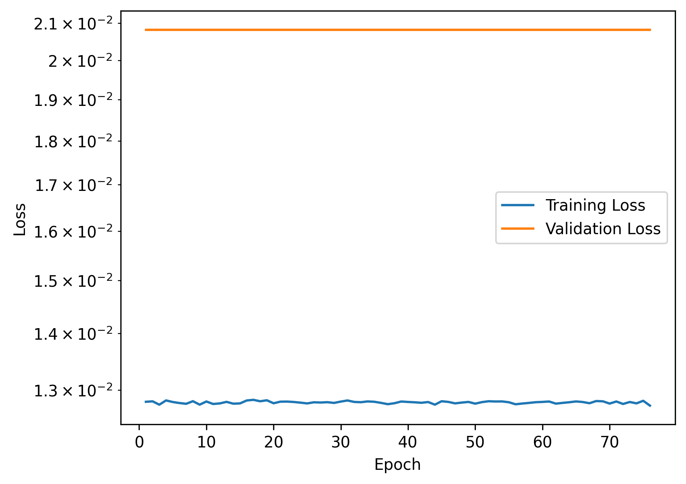
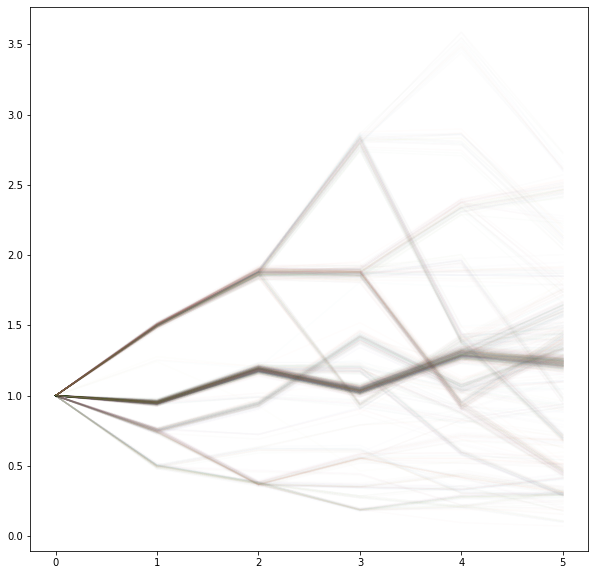
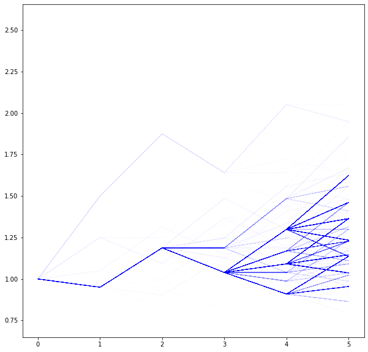
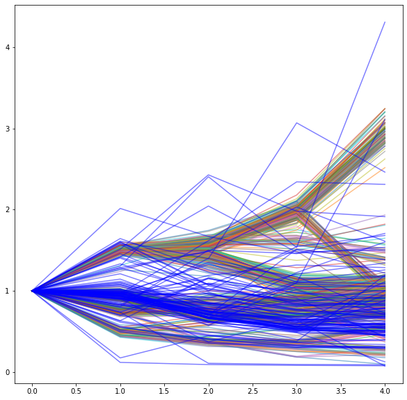

# Probabilistic Forecasting

When ChatGPT came out, I wanted to understand how sequence models work. The question I started with was simple: if a language model can predict the next word, can the same idea predict the next price? This repository records how that question changed as each approach failed in an informative way. It is a learning project (2023–2024), not a trading system.

The short version: **a model trained to predict one future learns the average of all possible futures.** The useful question is how to make a model represent several possible futures and how likely each one is.

## 1. GPT-2 with MSE: the mean collapse

[`01-gpt2-mse-forecaster/`](01-gpt2-mse-forecaster)

I adapted GPT-2 to numeric inputs with custom input/output embeddings and a ticker-identity embedding. I trained it with MSE to predict the next Open, Close, Low, High and Volume values from historical stock and crypto data.

The losses barely moved, and the predictions came out as nearly flat lines. On the test set, R² was close to zero for every price feature (Open 0.005, Close −0.034, Low −0.013, High 0.015; Volume 0.355), with an overall MSE of 0.088 ([`evaluate.ipynb`](01-gpt2-mse-forecaster/evaluate.ipynb)).

My interpretation was that this was not mainly a capacity or tuning problem. When the future is uncertain, MSE rewards predicting the mean of the possible outcomes. A single predicted path was the wrong output. The model needed to output a *distribution over paths*.

## 2. Synthetic branching futures and binned cross-entropy

[`02-binned-cross-entropy/`](02-binned-cross-entropy)

Real data only ever shows the one future that happened, so there is no ground truth for "all possible paths and their probabilities". To test whether a model can represent branching futures at all, I generated synthetic data from a random probability tree. Each step chooses a return from a fixed set of values with known probabilities, so every path and its probability is known.

I discretized the returns into bins and trained a transformer with cross-entropy, sampling autoregressively. Unlike MSE, this could represent several branches.

Two problems showed up:

- **Cross-entropy ignores how wrong a wrong bin is.** Predicting a bin next to the true one costs as much as predicting one at the other end. I added an MSE term on the trajectory to the cross-entropy loss (`BinnedCEPathMSELoss`), so near-misses cost less than distant ones.
- **Binning is lossy, and the error compounds.** Quantization error at each step fed into the next autoregressive prediction, even with the hybrid loss.

The notebook also includes a feedforward-network comparison.

## 3. Continuous outputs: Gaussian mixtures

[`03-gaussian-mixture/`](03-gaussian-mixture)

To remove the binning, I had the transformer output the parameters of a Gaussian mixture at each step and trained it with a mixture-density loss.

The sampled paths (blue) cover several of the true branches, but some branches are underrepresented and there are outliers. It was a step toward a continuous multimodal forecaster, not a solved one.

## Side exploration: tokenizing price series

[`exploration/`](exploration)

Language models work on tokens, so I tried to compress price histories into a vocabulary the same way. I clustered price segments between peaks and valleys with K-means, choosing parameters with elbow plots and a silhouette-score grid search. I did not train a forecaster on these tokens.

## Where this went

During an internship I came across diffusion policy, which models a distribution over action trajectories. It looked like the natural next step for representing multiple futures without binning. I didn't pursue it here: I stopped because I didn't think better stock-price prediction was worth much.

The underlying question carried over to my later work on world models for robot control: how to predict a future that has more than one plausible outcome, without averaging those outcomes into a prediction that matches none of them.

## Layout

| Folder | Contents |
|---|---|
| `01-gpt2-mse-forecaster/` | `build_dataset.py` (download and window price data), `model.py` (GPT-2 forecaster), `train.py`, `evaluate.ipynb`, saved data/model pickles |
| `02-binned-cross-entropy/` | Synthetic probability-tree data, binned cross-entropy + MSE loss, transformer and feedforward models |
| `03-gaussian-mixture/` | Mixture-density transformer on the same synthetic data |
| `exploration/` | K-means clustering of price segments as a tokenizer |
| `assets/` | Figures used above, taken from the notebooks' saved outputs |

The notebooks are research notebooks run at the time, kept as they were; I only removed warning and error tracebacks.
